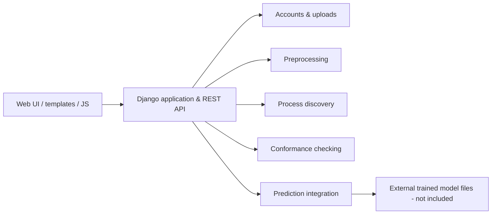

# Process Mining Platform

**Full-stack process analytics application built with Django, Django REST Framework, and integrated process-mining and predictive-model modules.**

Python · Django · DRF · HTML/CSS/JavaScript · Pandas · PM4Py · Scikit-learn · TensorFlow

> **Portfolio project (team collaboration).** I led most of the user-interface implementation and backend application development, and integrated process-mining / machine-learning modules implemented by teammates. Module authorship is described below and in [Contributions](docs/CONTRIBUTIONS.md).

## Overview

The application provides a web interface for uploading and preparing event logs, discovering process models, checking conformance, and accessing predictive-analysis features. It includes user accounts, role-based access, REST API endpoints, and a bilingual Persian/English interface.

**This is a curated copy of the submitted project source, not a hosted service or a production security audit.** Real UI screenshots and execution evidence will be added after they are captured from the original application. No simulated screenshots or fabricated performance metrics are shown.

## Capabilities

- **Accounts and dashboard:** registration, sign-in, role management, project navigation, and administrative views.
- **Data ingestion:** event-log upload and management, with CSV/XES-related processing paths.
- **Preprocessing:** data preparation and cleaning before process analysis.
- **Process discovery:** process-model generation and visualizations through PM4Py-backed modules.
- **Conformance checking:** compare observed event logs with discovered or provided process models.
- **Prediction integration:** API/UI paths for outcome, next-activity, and remaining-time estimation. **Model inference requires model files that are not distributed here.**
- **Bilingual UI:** English/Persian labels and translation management.

## Architecture



The diagram summarizes the structure found in the source tree; it is not a measured deployment architecture.

## My contributions

**Reyhaneh Rezaei — primary application developer & integrator**

- Designed and implemented **most of the frontend / user interface**.
- Developed **the majority of the Django backend application logic**.
- Integrated contributed process-mining and machine-learning/prediction modules into the web application, connecting their data flow, API endpoints, and screens.
- Coordinated the overall integration of the application components into one system.

**Collaborative work:** Core process-mining methods and prediction models were implemented by other project members/teams. These components are credited as collaborative work, **not claimed as solely my implementation**. The original project documentation also credits **Amir Hossein Saberi** as a team collaborator. See [Contributions](docs/CONTRIBUTIONS.md) for the module-level distinction. Team members have approved sharing the collaborative code, as confirmed by the project contributor.

## Technology and project layout

```text
process-mining-platform/
├── accounts/         # Auth, roles, dashboard, administrative pages
├── uploads/          # File and event-log workflows
├── preprocessing/    # Preprocessing service and API integration
├── discovery/        # Process discovery service and UI integration
├── conformance/      # Conformance integration
├── prediction/       # Inference integration + contributed model source
├── translations/     # Persian / English translation support
├── Group3/           # Contributed preprocessing module source
├── Group4/           # Contributed discovery module source
├── templates/        # Actual project HTML templates
├── static/           # Actual project CSS and JavaScript
├── config/           # Django configuration and URLs
├── docs/             # Contributions, security notes, model setup
├── requirements.txt
├── .env.example
└── manage.py
```

## Local setup (not yet revalidated in a clean environment)

The original project was developed as a team application. The following describes the intended setup; **dependency compatibility and complete end-to-end execution still need to be re-tested**.

1. Use Python 3.11 in a virtual environment (on macOS Intel, TensorFlow availability may require a supported Linux or cloud environment).

   ```bash
   python3 -m venv .venv
   source .venv/bin/activate
   python -m pip install -r requirements.txt
   ```

2. Configure a local environment:

   ```bash
   cp .env.example .env
   python3 -c "import secrets; print(secrets.token_urlsafe(50))"
   ```

   Replace the example `SECRET_KEY` value in `.env` with the generated secret. Never commit `.env`.

3. Initialize a **new local** database (original DB and uploaded content were intentionally excluded):

   ```bash
   python manage.py migrate
   python manage.py createsuperuser
   python manage.py seed_translations
   python manage.py runserver
   ```

   Open `http://127.0.0.1:8000/`. This is a development server only, not public deployment guidance.

**Prediction:** To enable prediction endpoints you must supply *your own trusted* compatible model artifacts in `prediction/trained_models/`; see [Model artifacts](docs/PREDICTION_MODELS.md). Do not load unknown pickle files or unverified pretrained binaries.

## Validation status

- Python sources were checked for **syntax**, but the entire Django application has **not** yet been run end to end in a fresh environment.
- No real application screenshots, benchmark values, or ML evaluation metrics were created for this public snapshot.
- Source archives contained a development database, uploaded user files, duplicated generated assets, and model artifacts; these were **excluded from the GitHub starter**. See [Security & data](docs/SECURITY_AND_DATA.md).
- Settings require an explicit Django `SECRET_KEY` and default to `DEBUG=False`; a predictable default admin password was removed. A malformed route in the supplied `config/urls.py` was also repaired. These edits should be reviewed against the original working environment.
- The dependencies in `requirements.txt` are an **unverified reconstruction** from imports, not a frozen working environment.
- **Not production ready:** no external security assessment, deployment smoke test, load test, or reliable CI integration test has been performed.

## License and project context

The team approved publishing the code for portfolio purposes. No open-source license is included at this stage; permission to view this source is not the same as a grant to reuse all components or data. Any license choice should be agreed with the contributors. The original project code and design remain credited to their respective contributors.

**Portfolio contact:** Reyhaneh Rezaei · [GitHub profile](https://github.com/reyhanehrezaei-dev)
